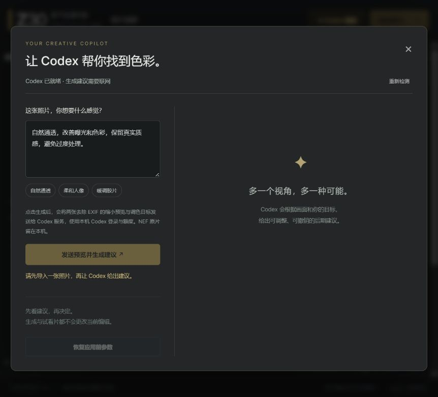

# Z30 Studio

为尼康 Z30 使用者制作的中文本地 RAW 暗房，支持 NEF 显影、Codex CLI 及 DeepSeek / OpenAI 兼容视觉接口辅助调色。独立项目，与尼康官方无关联。

交给其他开发者或 AI 接手：先读 [项目交接说明](AI_HANDOFF.md)，可直接使用 [接手提示词](HANDOFF_PROMPT.txt)。



## 功能

- 使用 rawpy / LibRaw 解码 NEF，支持相机、自动和日光白平衡。
- 调整曝光、对比度、高光、阴影、色温偏移、色调、饱和度、自然饱和度和锐化。
- RGB 直方图、原片对比、自定义风格预设、旋转及居中比例裁剪。
- 导出全尺寸 JPEG / 8 位 PNG / 16 位 RGB TIFF，附带 sRGB ICC；保存和载入 JSON 调色参数。
- 让 Codex 根据预览和文字目标提出调色建议，先看试片、调整强度，再应用或恢复应用前参数。
- 一键 GPT 自动调色：分析当前照片、画质保护、本地渲染验证后直接应用，支持取消、撤销及查看分析。
- 检查输出通道、层次、色度及暖色偏移，必要时降低 Codex 建议强度；手动导出可自行开启画质保护。
- 后台批量导出、ZIP 下载和失败项重试；预览采用 128 MiB 上限的内存缓存。
- 多步撤销 / 重做、编辑历史；保存含原片副本的便携项目，服务重启后继续编辑。
- 真正从全尺寸显影结果读取 100% 像素，支持区域导航和无损预览缓存。
- 每张独立分析的 AI 批量调色，支持共同风格、强度与改动上限，记住个人偏好。
- 渐变 / 径向 / 画笔局部蒙版，亮度 / 色彩降噪，手动畸变 / 色差 / 暗角及配置保存。
- 刷新页面恢复照片、编辑参数与 AI 撤销点；分析断线后恢复原任务，完成文件支持逐张下载和流式 ZIP。

新增功能、限制、分阶段提交和性能记录见 [完整工作台说明](docs/workbench.md)。

## Windows 启动

支持免安装 EXE 便携包：完整解压 `Z30-Studio-Windows-x64.zip`，双击 `Z30-Studio.exe`，保留 `_internal` 文件夹；无需安装 Python。启动窗口负责打开网页和停止服务。详见 [便携版说明与构建方法](docs/windows-portable.md)。AI 仍需已登录的本机 Codex CLI。以下为源码启动方式。

需要 **64 位 Python 3.12 或更新版本**。下载或克隆仓库后，双击 `start.bat`。首次启动会创建本项目专用的 `.venv` 并联网安装依赖，随后自动打开浏览器。

默认地址为 `http://127.0.0.1:8730`；端口被占用时会自动选择空闲端口，请以启动窗口显示的地址为准。保持启动窗口运行，按 Ctrl+C 结束服务。

也可以手动运行：

```powershell
python -m venv .venv
.\.venv\Scripts\python.exe -m pip install -r requirements.txt
.\.venv\Scripts\python.exe server.py
```

界面无需 Node.js、构建步骤或外部 CDN。手动显影在依赖安装完成后可离线使用。

## 一键 AI 自动调色

导入照片后，点击右侧 **一键 AI 调色**。无需填写目标：软件自动按自然、有节制的方向判断曝光与色彩，经本地画质检查和渲染验证后直接应用。点击 **撤销上次 AI 调色** 恢复点击前参数；也可查看分析记录。该操作作用于当前照片，导出仍由你选择。

默认 Codex 模式复用现有 CLI 登录、默认模型、图片输入和结构化输出，无新增必需的 API Key、SDK 或付费 API 依赖；可选 DeepSeek / 兼容模式需自备 API Key 并使用服务商额度。每次点击只提交一次模型分析，不自动重复扣额度重试。点击即发送两张去除 EXIF/GPS 的缩小预览，原始 NEF/JPEG/PNG 保持不变。分析期间改参数、切换或移除照片会阻止自动覆盖；取消、模型错误或渲染失败不会应用参数。实现与验证见 [自动调色设计](docs/auto-grade.md)。

## Codex 辅助调色

选择 Codex 后端时，需要本机已安装并登录官方 Codex CLI，且账户有可用权限和额度。未登录时，请在终端运行 `codex login`。软件会从 PATH 或 Windows Codex 安装位置查找 CLI；也支持将环境变量 `Z30_CODEX_PATH` 指向其可执行文件。

导入照片后，点击 **✦ AI 辅助**，输入目标，例如“自然通透，提亮阴影，保持真实色彩”，然后点击“发送预览并生成建议”。生成建议不会自动改变当前编辑；试片、应用和恢复均由你控制。

该功能通过 `codex exec` 的图片输入与结构化 JSON 输出接入，使用 CLI 的已保存登录状态和默认模型。单次分析不加载用户 config.toml，使用只读沙盒并禁用 shell 工具及网页搜索。程序不读取或复制 `auth.json`，网页不接收 API 密钥。

## DeepSeek 与兼容接口

打开顶部 **模型设置**，选择 **DeepSeek 官方视觉接口**，在软件里填写 API Key 并保存。预设使用官方 `https://api.deepseek.com` 和支持图片的 `deepseek-flash`。也可选择自定义兼容视觉接口，填写 Base URL 和模型名；无需安装 OpenAI SDK，也无需安装 Codex CLI。

Key 仅保留在本次运行内存中，不写入项目、日志、浏览器存储或磁盘配置；重启后需重新填写。测试连接只读取模型列表，不发送照片、不发起推理。点击分析后才发送两张缩小预览并使用对应服务商额度；取消只保证停止本机应用，服务商仍可能计费。默认保留 Codex CLI 后端及其原有登录方式。实现、可选环境变量和已验证范围见 [多模型接入说明](docs/model-backends.md)。

## 照片与隐私

手动显影只在本机执行，服务仅监听 `127.0.0.1`，原始 NEF 不会被覆盖。

**Codex 辅助和 GPT 自动调色需要联网。** 只有点击生成建议、一键 AI 调色或启动逐张 AI 批处理后，才会向当前选择的后端发送两张去除 EXIF / GPS、最长边不超过 1600 像素的 JPEG 预览及调色目标；NEF 原片不上传。画面内容仍会交给 Codex 分析，请按照片内容自行选择是否启用。试片强度调整不再次调用模型。

原片临时副本在移除照片或服务正常退出时清理；强制结束可能留下系统临时文件。编辑状态保存在当前页面会话中，关闭前请按需保存项目（含原片副本）或下载调色参数。

同一标签页刷新时，会尝试从本机服务恢复照片，并从浏览器 sessionStorage 恢复参数和 AI 撤销点。后台每 30 秒续期；超过 30 分钟未活动的会话会清理临时照片、缓存和分析任务。每页最多 8 张，进程最多 32 张。关闭浏览器标签页或重启服务后，临时照片不保证恢复；可打开此前保存的 `.z30proj` 项目恢复原片、参数与历史。浏览器自动保存空间不足时会缩减历史，项目保存保留最多 50 步。网络中断只重试读取分析状态，不会重新调用模型；未确认取消时，按钮改为重新连接原任务。

**后台导出另存本机快照。** 加入队列后，输入快照、参数和结果保留在项目的 `.data/exports/`，关闭照片不影响导出，重启后可手动重试未完成项。在“后台任务”中删除任务才会清除这些副本；原始照片保持不变。上限为 20 个任务、总计约 1 GiB，每批最多 8 张且输入合计不超过 512 MiB。该目录已排除在 Git 和发布源码包之外。

ZIP 直接在下载时流式生成，不再保存第二份 ZIP 占用任务空间。任意任务状态下，只要单张已完成即可下载；下载过程中需等传输结束后再删除或重试该任务。四项稳定性修复、复现与测试见 [优化记录](docs/reports/reliability-optimization.md)。

## 测试与边界

已用公开的 Z30 12 位、14 位无损压缩 NEF 验证解码、方向、有效画面裁切和导出；已真实调用 Codex 验证建议、试片、应用、恢复及全尺寸导出。详细过程见 [验证记录](验证记录.md)。

运行本地接口契约测试，不会调用 Codex 或消耗模型额度：

```powershell
.\.venv\Scripts\python.exe -m unittest discover -v
node --test tests/*.test.cjs
```

局部蒙版、传统边缘感知降噪及手动镜头修正已实现；没有 AI 降噪、自动匹配的实镜标定库或自由裁剪框。色温 / 色调是相对偏移，不是精确 Kelvin 校准。RAW 外观不会完全复现尼康 Picture Control；预览与全尺寸导出的细节可能有差异。建议效果需逐张评估。

修改阶段、测试范围、实机验证限制及耗时 / 内存比较见 [分阶段修复报告](docs/reports/staged-repair.md)。

当前本地测试为 104 项 Python 和 25 项 Node，保留原有 11 项 CLI 契约测试，并提供真实 12/14 位 Z30 NEF 回归。新增 1 项 Windows 启动器无头退出回归及 2 项后台导出有界关停/重启清理回归；其他系统会跳过启动器进程测试。其他 RAW 方向、活跃边距及暖色保护使用合成夹具；没有实拍人像色卡、打印 CMYK 或更多方向样片验证。画质检测是预览上的启发式指标，不是审美评估、精确噪声测量或人脸检测。CI 未提供 NEF 时明确跳过两项真实 RAW 测试。

## 文档与依赖

- [完整使用说明](使用说明.md)
- [rawpy](https://github.com/letmaik/rawpy) / [LibRaw](https://www.libraw.org/)
- [NumPy](https://numpy.org/) / [Pillow](https://python-pillow.org/)
- 参考 [darktable](https://www.darktable.org/about/features/) 的无损编辑工作流与 [RawTherapee](https://rawtherapee.com/) 的高精度处理思路；界面和调色代码独立编写。
- Codex 官方文档：[非交互模式](https://learn.chatgpt.com/docs/non-interactive-mode)、[命令行参数](https://learn.chatgpt.com/docs/cli/reference)。

仓库不包含第三方运行库二进制；依赖由 pip 安装，各依赖适用其自身许可。
