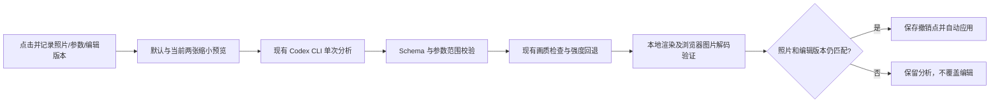
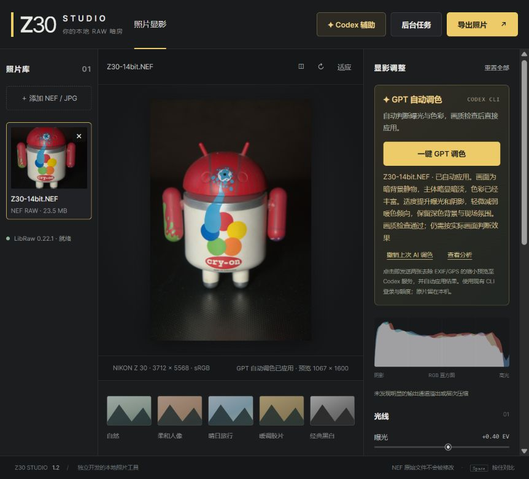

# 一键 GPT 自动调色

导入一张照片，点击右侧“一键 GPT 调色”。软件为当前照片完成一次模型分析、画质检查、必要的强度回退和本地渲染，然后直接应用。无需先写目标或再点应用。已有手动建议流程继续保留；自动模式不替用户选择导出位置。

## 流程与复用

- `POST /api/codex/auto`：复用 `Advisor.submit`、两张去除 EXIF/GPS 的 JPEG、`codex exec --image` 和 JSON Schema。使用固定自然调色目标，模型输出相对原片的完整参数。
- `codex_assist.AUTO_GOAL`：保留场景氛围、肤色和已有风格；黑白保持黑白，图像已经合适时允许保持参数。它是目标，不保证模型的审美判断正确。
- `server.filter_advice`：继续使用 `quality.guard`，按 100/75/50/25/0% 回退；不额外调用模型，不改变白平衡模式、裁剪和旋转。
- `GET /api/codex/jobs/:job`：异步获取分析/检查/完成状态。
- `POST /api/preview`：在应用前验证实际显影输出，复用已有缓存；浏览器成功解码图片后才提交编辑。
- `POST /api/codex/cancel`：核对照片归属，取消对应 CLI 子进程并使已完成但未应用的结果失效。正在退出的 worker 结束前，不允许另一个模型请求。

CLI 登录、默认模型、只读沙盒、禁用 shell/网页搜索、用户配置隔离和原有输出校验均保持现状。无需新 API Key、SDK 或付费 API 依赖；使用已有 Codex 账户的额度。[官方非交互模式](https://learn.chatgpt.com/docs/non-interactive-mode)及[命令行参数](https://learn.chatgpt.com/docs/cli/reference)说明了图片输入和结构化输出接口。

## 编辑与失败处理

`web/auto-grade.js` 管理流程；`web/app.js` 负责界面和现有照片编辑状态。任务记录照片对象、完整参数和全局编辑版本，在分析后、渲染后分别检查。即使用户改过参数又恢复同样数值，或者切走又切回同一张照片，编辑版本变化也会阻止自动应用。

应用动作同步保存参数/预设撤销点，并使此前尚未完成的旧预览失效。查看分析可看到模型说明与画质回退；撤销会恢复上次 AI 应用前的参数，并撤回此后手动修改，与原有辅助模式的撤销规则一致。

用户取消立即禁止自动应用，即使服务端取消失败。任务编号尚未返回时取消，也会在收到编号后补发取消。取消失败时界面明确说明未确认服务端停止，不保证取消已送达远端的请求或退还额度。CLI 分析保留 180 秒超时，浏览器等待约 210 秒并设单次 HTTP 超时；失败不会自动重复模型调用。

关闭照片会沿用任务失效机制。同一页刷新可恢复照片、参数、AI 撤销点和未确认的请求编号；取回分析只供查看，不会静默覆盖新页面编辑。浏览器存储不可用或服务重启后不保证恢复。刷新不会自动重新提交模型分析，也不保证取消远端已接收请求。详细行为见 [稳定性优化](reports/reliability-optimization.md)。

## 验证与边界

当前本地 Python **74 项通过**（包含原有 11 项 CLI 契约测试、实际 12/14 位 NEF），Node **15 项通过**。新增覆盖自动任务的真实 HTTP/本地显影、所属照片校验、缺 CLI、已取消 worker 阻止新请求、重复点击、编辑版本、迟到结果、渲染失败、非法结果和超时取消。CI 不提供 NEF，明确跳过两项实际 RAW 方法，其他回归及 Node 流程测试运行于 Windows/Linux。

自动画质保护仍是缩小预览上的启发式指标，不能替代实拍色卡、肤色或全分辨率检查。GPT 只调整九个全局参数，保留另行设置的局部蒙版、传统降噪与手动镜头修正；没有 AI 降噪或高光细节生成。工作台扩展见 [说明](workbench.md)。其他相机方向及实拍人像色卡仍保持前次修复报告中的未验证范围。

### 真实 CLI / 浏览器验证

使用此前公开 CC0 的 Z30 14 位 NEF（raw.pixls.us ID 5813）真实调用一次本机 Codex CLI（0.164.0-alpha.11.1，默认模型）。从按钮启动、分析、检查到自动应用均完成，无需打开建议面板或点击第二次应用。输出曝光 +0.4 EV、高光 -10、阴影 +12、色温 -4、饱和度 -3，构图和白平衡模式保持不变。查看分析可见模型说明与画质记录。

保存应用后的 JSON，点击撤销后再次保存，确认全部参数恢复到点击前的默认值；原始 NEF SHA256 仍为 `03d94c1f184c4236ea8f890ab0fe30e91b65965e8b09cebecc397fba081a607f`。实际参数与撤销核对见 [记录](reports/auto-grade-live.json)。取消和编辑竞态使用确定性本地测试验证，未为它们额外消耗真实模型额度。这张静物样片不能证明实拍人像或所有场景的自动调色质量。

