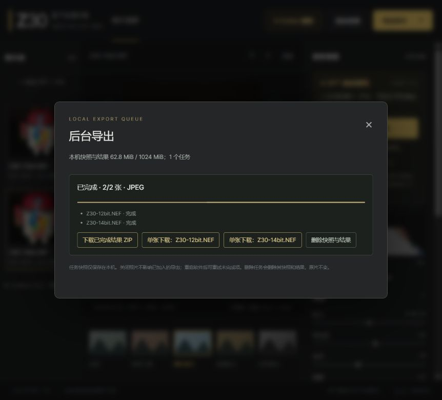

# Reliability optimizations

These changes address four independently reproduced review findings. Original photos remain unchanged; existing Codex CLI login and model access are retained.

## 1. Export retrieval and disk usage

`export_jobs.py`, `server.py`, `web/app.js`: completed files are downloadable individually in any task state. ZIP is generated directly into the HTTP stream, without a second stored copy or a full ZIP memory buffer. Download readers pin only their own job; queue metadata operations do not hold a lock for the entire network transfer. Retry/delete cannot invalidate an active download, and disconnected readers release their pin.

Regression: two 4096-byte outputs within a 12000-byte task budget now complete and can be retrieved in a valid streamed ZIP, although storing another ZIP copy would exceed that budget. Legacy jobs marked failed still expose completed files. HTTP tests read the connection-framed ZIP and each individual image. No input snapshots or user originals are removed by this optimization.

## 2. Recoverable analysis identity

`codex_assist.py`, `server.py`, `web/auto-grade.js`, `web/app.js`: each automatic click has a random request ID bound to source, parameters, goal and mode. Repeating a submission with that identity returns the original job, including completed/cancelled jobs; changed parameters are rejected. Request lookup restores a lost submission response without starting a model request. Transient GET failures retry at most twice, then request remote cancellation. Unconfirmed cancellation exposes a reconnect-only action, preventing an accidental new model submission. History is capped at 256 records per process instead of silently evicting idempotency records.

Regressions cover duplicate HTTP submissions, source-scoped lookup, parameter conflicts, cancellation identity, lost responses, transient polling recovery, bounded failure/cancellation and reconnect without a second model job. Neither retries nor regression tests invoke an additional live model.

## 3. Page-owned photo sessions

`server.py`, `web/app.js`: the browser tab keeps a random client ID in sessionStorage. Refresh restores the same photos and locally saved parameters/AI undo point, rather than allocating another set of invisible sessions. Pending analysis IDs survive refresh but are recovered as reviewable results, never silently auto-applied after a new page load. Photo access and analysis lookup check page ownership. Heartbeats every 30 seconds retain active sessions; a maintenance thread reclaims sessions unused for 30 minutes, their cache, temporary inputs and analysis jobs. Each tab allows 8 photos and the process has a 32-photo bound.

HTTP regressions restore eight photos and parameters, remove one and successfully import another, and verify expiration cancels jobs/deletes only temporary copies while another tab's heartbeat and ownership remain intact. Browser storage must be available for refresh recovery. Restarting the backend still removes temporary photos; users must reimport originals and load their downloaded recipes. This does not silently retain originals on disk indefinitely.

## 4. Clipping checks before spatial averaging

`quality.py`, `tests/test_quality_cache.py`: channel/white/black/highlight counts use all rendered preview pixels in bounded-height strips before resize. Per-channel and regional counts accompany the existing compact tone/chroma/texture metrics. Quality fallback still uses a cheap reduced preview to reject obvious bad candidates, but every accepted candidate is rechecked against the native preview, so downsampling cannot conceal new pixel-limit clipping at that resolution.

Regressions recover the exact 50% clipping of an alternating black/white test image (previously reported as zero) and force fallback when a coarse preview hides clipping but native preview does not. The successful check applies to the decoded preview, not every sensor/full-export pixel; no claim of RAW highlight recovery, calibrated skin detection or exact noise measurement is added.

## Final validation and performance

Local suite: 74 Python methods passed with both real Z30 samples, plus 15 Node flow tests. All original CLI contract tests are retained. CI explicitly skips the two real-RAW methods when external sample files are absent. No live model request was made for these reliability changes.

| 14-bit sample stage | Prior seconds / peak MiB | Current seconds / peak MiB |
| --- | --- | --- |
| decode_full | 1.088228 / 401.2 | 1.036097 / 401.3 |
| develop_full | 4.438923 / 431.3 | 4.388985 / 431.3 |
| preview_pipeline_cached | 0.552783 / 155.3 | 0.636943 / 155.6 |
| preview_pipeline_repeat | 0.000024 / 155.6 | 0.000029 / 155.5 |
| export_tiff16 | 8.433948 / 632.8 | 8.286925 / 632.6 |

Two independent-process repeats per stage on the same host, with prerequisite decoding/rendering included in OS peak RSS. Colour output means and clipped-output fractions match the previous renderer: these changes do not alter its tone/colour mapping. The stronger full-preview metric adds about 84 ms to this uncached preview; cache-hit time remains below 0.1 ms for the server function, excluding transport/browser work. TIFF export retains roughly 633 MiB peak RSS. ZIP no longer duplicates completed payloads on disk, and does not load the whole archive into RAM.

Remaining limits: recovery requires the original server process and page sessionStorage; closing a tab or restarting the server does not guarantee photo recovery. Leases expire after 30 minutes without heartbeat. Network loss may prevent confirmation that a remote request was stopped; reconnect lookup never submits a new analysis. Clipping checks apply to decoded preview pixels, not all full-resolution sensor data. More real portraits/lighting conditions and calibrated colour targets remain unverified.

## Interactive verification

Imported the public 12/14-bit NEFs, applied the travel preset, refreshed and confirmed both photos plus contrast +12/highlights -20/shadows +15/vibrance +25/sharpen +18 survived. Exported both, downloaded the streamed ZIP and an individual JPEG, and checked that both outputs are 3712×5568 with ICC. The individual JPEG is byte-identical to its ZIP entry. The 21,400,889-byte ZIP is not duplicated in the export job directory. Only this generated test job was removed afterward; both original source hashes stayed unchanged.

Integration review also caught preview width/height overwriting source metadata during restore. The merge order now preserves source dimensions and carries separate previewWidth/previewHeight. The HTTP regression checks a rotated square crop, and the actual 14-bit photo still reports 3712×5568 after refresh, alongside its 1067×1600 preview. Browser console had no errors. No live model call was used.

