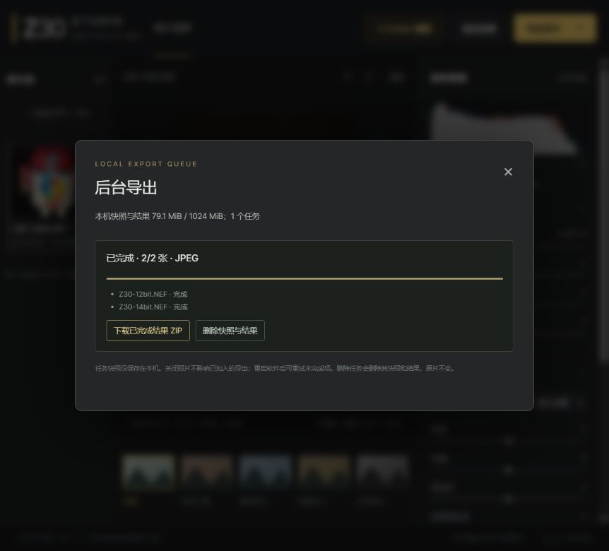
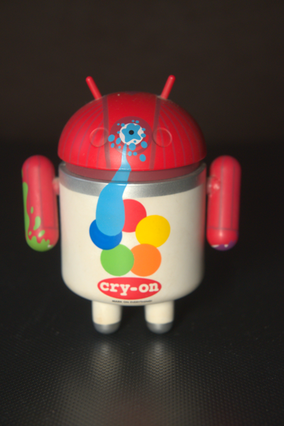
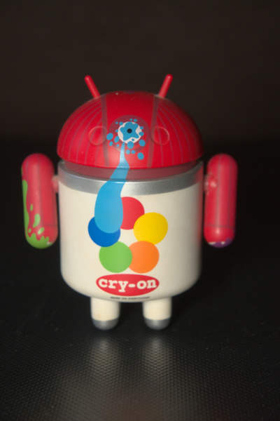

# Staged image pipeline repair

Baseline: commit `4a5c38e`. Changes are implemented in source, with a separate commit per priority stage. All fixtures are generated or the previously documented CC0 Z30 samples; no private photos or Codex credentials are part of this report.

## P0 — geometry and input colour (`a14ceab`)

| Requirement | Changed files | Verification |
| --- | --- | --- |
| Sensor crop / orientation / preview alignment | `imaging.py`, `server.py`, `tests/test_imaging.py` | Sensor-relative inset translated against active margins; all eight LibRaw transforms; fractional odd half-size edges; invalid crop and unexpected shape handling; user rotation/crop combinations |
| JPEG/PNG colour management | `imaging.py`, `server.py`, `web/app.js` | ICC sRGB and synthetic wide RGB, palette ICC, gray/alpha, 16-bit grayscale precision, linear-light alpha composition, PNG gAMA, corrupt or mismatched ICC and untagged CMYK rejection; import warnings visible in the app |
| Different orientations / colour / RAW depth | `tests/test_imaging.py`, `tests/color_profiles.py`, `tests/README.md` | 28 tests including the original 11 Codex tests; actual 12/14-bit Z30 NEF hashes and 3712×5568 portrait dimensions preserved; 1067×1600 previews aligned to full development |
| Reproducible comparison | `tools/benchmark_pipeline.py`, report JSON files | Two isolated-process repeats per sample; wall-clock medians and OS process peak RSS, not Python-only allocator counts |

The old implementation was independently executed before replacement. A crop with active margin (2,2) and sensor inset (4,4,8,6) incorrectly returned (4,4,8,6), instead of active-relative (2,2,8,6). A 50% transparent black pixel was decoded as linear (0,0,0), rather than approximately (0.498,0.498,0.498) over white. Untagged CMYK was silently interpreted via a generic RGB conversion. These observations are recorded in `reproduced-bugs.json`.

P0 residual risks / unverified cases:

- Only LibRaw flip=5 is present in the two actual camera samples. Other orientations, active margins and odd inset boundaries are synthetic regression checks, not additional camera captures.
- The wide-gamut ICC fixture is a generated matrix/TRC profile, not a display calibration. Real printer-specific CMYK rendering has not been verified against print targets. Missing CMYK profiles are rejected instead of guessed.
- Non-square-pixel RAW and 16-bit RGB/RGBA PNG input are explicitly rejected. Gray 16-bit PNG is supported. This prevents Pillow's implicit reduction of RGB PNG to 8 bits from masquerading as a high-depth decode.
- Full-resolution and half-size demosaicing may differ in fine detail. The real-RAW check uses an explicit linear-light mean absolute error threshold, not a claim of bit-identical demosaicing.
- Untagged RGB is necessarily ambiguous: the app warns and assumes sRGB. Valid PNG gAMA/cHRM or explicit EXIF Adobe RGB is honored. ICC profiles take priority over those hints.

All source images remain read-only inputs. Source NEFs and local snapshots are excluded from Git. Only small derived CC0 comparison thumbnails and an interface screenshot are included for review.

## P1 — tone, high-depth export, task lifecycle and performance (`8ac2b4d`)

| Requirement | Changed files | Verification |
| --- | --- | --- |
| Smooth tone / shoulder / shadows | `processing.py`, `server.py`, `tests/test_processing.py` | Black-anchored monotonic luminance mapping, C1 rational shoulder and a bounded quadratic-sampled tone table; interpolation error below 2e-6 linear units in the tested range |
| Clipping, warm hues and saturation | `processing.py`, `tests/test_processing.py` | OKLab hue-axis saturation, chroma reduction for out-of-gamut pixels, soft moderation of positive boosts in a warm hue band; synthetic warm patches, neutrals and saturated inputs |
| True RGB16 TIFF | `server.py`, `processing.py`, `requirements.txt`, `start.ps1`, `web/index.html`, `web/app.js` | UInt16 RGB TIFF with 16 bits/sample, 3 channels, sRGB ICC and more than 256 levels; sharpening remains float32; actual 14-bit NEF TIFF round-trip and HTTP response verified |
| Async/photo lifetime | `codex_assist.py`, `server.py`, `web/app.js`, `tests/test_lifecycle.py`, `tests/test_http.py` | Close kills a running child, late results cannot publish, completed stale results are invalidated, server returns HTTP 410, shutdown rejects new jobs; existing CLI auth and command flags retained |
| Per-stage performance | `tools/benchmark_pipeline.py`, isolated report JSON files | Fresh process for each decode / preview / development / JPEG encode / TIFF export stage; no input array is needlessly retained while measuring a separate TIFF export |

An initial exponential shoulder failed the neutral/highlight regression because it rounded bright values prematurely to the export maximum. The actual curve was replaced by a rational tail; the original strict test was retained. A coarse initial tone lookup failed the 2e-6 error bound; its sampling density was increased instead of loosening the test. Colour fixtures now use independent W3C reference matrices rather than sharing the production xy-to-matrix implementation.

The final P1 suite has 44 tests, including all 11 original tests. CI is added for generated-fixture regressions on Windows and Linux. Real RAW samples are optional and explicitly skipped when not provided; they were supplied for local validation.

P1 residual risks / unverified cases:

- Tone and colour appearance deliberately differ from the old clipping-based pipeline. This is not colour-target calibration or equivalence to Nikon rendering.
- The warm hue band is a heuristic, not a face/skin detector. Only generated warm patches have a numeric hue-preservation test; no real skin colour target or portrait camera sample was supplied.
- The high-depth path retains LibRaw's 16-bit output and float32 processing, but cannot recover data already clipped by the sensor or by LibRaw's integer RGB output.
- The 32,769-node tone table has a measured numeric approximation bound; it is not an assertion of bit-identical output to analytic evaluation at all possible float inputs.
- Closing a photo terminates its local Codex process and rejects late output. This does not promise cancellation/refund of a request already received by a remote service.
- Cancellation and publication races are deterministic fake-process tests. No additional paid API dependency or quota-consuming live Codex test was introduced; CLI authentication and existing tests are preserved.
- Printer-specific CMYK, non-square RAW, 16-bit RGB PNG and actual camera orientations other than flip=5 retain the P0 verification limits.

References: [LibRaw sizes](https://www.libraw.org/docs/API-datastruct.html), [Pillow CMS](https://pillow.readthedocs.io/en/stable/reference/ImageCms.html), [PNG metadata](https://www.w3.org/TR/png-3/), [W3C colour conversion reference](https://www.w3.org/TR/css-color-4/#color-conversion-code), [OKLab](https://bottosson.github.io/posts/oklab/), [tifffile](https://www.cgohlke.com/docs/tifffile/).

### P0 benchmark (actual 14-bit sample, same host)

| Stage | Baseline seconds / peak MiB | P0 seconds / peak MiB |
| --- | --- | --- |
| decode_full | 1.1181 / 632.2 | 1.0475 / 399.1 |
| decode_preview | 0.5083 / 632.2 | 0.4686 / 399.1 |
| decode_preview_cached | 0.0000 / 632.2 | 0.0000 / 399.1 |
| develop_full | 4.7400 / 632.2 | 5.1048 / 612.5 |
| encode_jpeg | 0.1055 / 632.2 | 0.1035 / 612.5 |
| preview_pipeline_cached | 0.6670 / 632.2 | 0.7118 / 612.5 |

12bit full-output comparison thumbnail (same stress settings): mean absolute 8-bit difference 0.000000, maximum 0. Output comparison is not a colour-target accuracy measurement.

14bit full-output comparison thumbnail (same stress settings): mean absolute 8-bit difference 0.000000, maximum 0. Output comparison is not a colour-target accuracy measurement.

### P1 paired isolated benchmark (actual 14-bit sample)

| Stage | Baseline seconds / peak MiB | P1 seconds / peak MiB |
| --- | --- | --- |
| decode_full | 1.1658 / 632.5 | 1.0335 / 400.2 |
| decode_preview | 0.5201 / 187.9 | 0.4728 / 155.0 |
| decode_preview_cached | 0.0000 / 187.9 | 0.0000 / 154.8 |
| develop_full | 4.7201 / 632.6 | 4.4071 / 430.0 |
| encode_jpeg | 0.1225 / 632.5 | 0.1208 / 429.9 |
| preview_pipeline_cached | 0.6949 / 187.9 | 0.5441 / 154.5 |
| preview_pipeline_repeat | 0.6713 / 187.8 | 0.4883 / 154.8 |
| export_tiff16 | not implemented | 8.3051 / 632.3 |

Under the same stress settings, 14-bit sample red-channel export-maximum incidence fell from 1.7394% to 0.3595%. This counts 8-bit values equal to 255, not sensor highlight recovery.

RGB output means changed from [80.51275424299568, 58.87389730301538, 53.30851386966471] to [73.17891821027794, 52.561851087185396, 47.875210853120045]; the shoulder/WB/colour changes intentionally alter appearance and are not a claim of measured camera colour accuracy.

Two repeats per stage. Performance is host-specific. Both RAW file hashes are recorded in the JSON reports.

### P0 follow-up — mirrored import metadata (`b653ee0`)

Final integration review caught a remaining metadata branch that swapped width and height only for flips 5/6, despite the pixel transform supporting all eight directions. `server.py` now also reports swapped dimensions for mirrored transpose flips 4/7. `tests/test_imaging.py` imports all eight synthetic RAW metadata fixtures and independently checks the reported dimensions. The committed follow-up snapshot passed 45 tests, with both real NEFs supplied. Actual camera samples still cover only flip=5.

## P2 — quality checks, cache and durable batch exports

| Requirement | Changed files | Verification |
| --- | --- | --- |
| Automatic quality checks and fallback | `quality.py`, `server.py`, `codex_assist.py`, `web/app.js`, `tests/test_quality_cache.py`, `tests/test_lifecycle.py` | Output clipping/white area, tone span, chroma and warm-hue drift compared with the prior preview; try 100/75/50/25/0% strength; preserve composition and categorical WB; filter runs before publishing advice |
| Bounded preview caching | `cache.py`, `server.py`, `tests/test_quality_cache.py` | Byte-accounted LRU (128 MiB), read-only decoded arrays, rendered results and baseline reuse; distinct parameters miss; closing a source purges it |
| Batch/background/recovery | `export_jobs.py`, `server.py`, `web/index.html`, `web/app.js`, `web/assistant.css`, `.gitignore`, `tests/test_export_jobs.py`, `tests/test_http.py` | One worker; immutable local input snapshots and SHA256 checks; atomic manifests/output publication; failed-item-only retry after restart; cancellation prevents late output; ZIP downloads, root ownership/path/storage limits |
| CI execution | `.github/workflows/tests.yml` | Fixed a real YAML parse failure in the initial P1 workflow by using a block scalar for the pip command. CI results must be read from actual checks, not inferred from adding the workflow |

Final local verification: **63 tests passed**, including all 11 original tests and the two real-RAW integration methods. `node --check web/app.js`, Python compilation and `git diff --check` also pass. No original CLI tests were removed or weakened; this repair did not invoke a model, change CLI login or introduce paid API dependencies.

Browser verification imported both public Z30 NEFs, queued a protected JPEG batch, removed the 12-bit photo while the queue worked, and downloaded two valid 3712×5568 JPEGs with ICC profiles. Queue test snapshots were deleted afterward through the local API. Automated HTTP tests also close both source sessions before downloading two valid PNGs. The real 14-bit TIFF test checks uint16 RGB, 16 bits/sample and levels inconsistent with an 8-bit-to-16-bit expansion.

P2 residual risks / unverified cases:

- Detection is a heuristic over a reduced preview (guard up to 512 px, metrics up to 384 px), not an aesthetic score or a guarantee about every full-resolution pixel. Detail/noise values are texture proxies and cannot separate real detail from noise. Warm-hue checks do not identify faces.
- No real skin target, calibrated display/printer comparison, or wider set of camera orientations was supplied. Those limits remain explicitly unverified. No new live Codex call was made; its result filtering/cancellation is verified with deterministic processes and local images.
- Durable jobs retain originals' local copies and exports until deleted. They are excluded from Git/source archives, limited to 20 jobs and about 1 GiB in total, with a 512 MiB input limit per batch. Missing or corrupted input snapshots require a new import, not a promise of recovery from lost data.
- Recovery requires clicking retry. Completed items are retained; batch processing applies one chosen parameter set to all selected photos, with per-photo fallback only if requested. It is not independent AI analysis for every photo.
- Native decode/encode cannot be interrupted at arbitrary instructions; cancellation stops publication at safe points. Active cancellation must finish before retry/delete. A single background worker limits export concurrency; simultaneous editor work can raise process RSS above the isolated benchmark figures.
- Cache-hit numbers measure the server function only, excluding HTTP JSON transfer, base64 decoding, browser layout and painting. New settings still incur a render. TIFF compression remains the largest measured export memory peak.

### P2 paired isolated benchmark (actual 14-bit sample)

| Stage | Baseline seconds / peak MiB | P2 seconds / peak MiB |
| --- | --- | --- |
| decode_full | 1.165799 / 632.5 | 1.088228 / 401.2 |
| decode_preview | 0.520098 / 187.9 | 0.460712 / 155.1 |
| decode_preview_cached | 0.000006 / 187.9 | 0.000032 / 155.6 |
| develop_full | 4.720089 / 632.6 | 4.438923 / 431.3 |
| encode_jpeg | 0.122497 / 632.5 | 0.106403 / 431.7 |
| preview_pipeline_cached | 0.694901 / 187.9 | 0.552783 / 155.3 |
| preview_pipeline_repeat | 0.671283 / 187.8 | 0.000024 / 155.6 |
| export_tiff16 | not implemented | 8.433948 / 632.8 |

Two fresh-process repeats per stage, median wall time and maximum OS peak RSS including prerequisite decode/render. Both sample hashes and all measurements are recorded in `p2-isolated.json`. This is a same-host comparison, not a universal speed claim. The preview cache hit is about 0.024 ms for the 14-bit sample, excluding transport and browser work.

The P2 full-development thumbnail is pixel-identical to P1 for both supplied NEFs. Under the same stress settings (exposure +0.75, highlights -35, shadows +20, temperature +14, tint -3, saturation +10, contrast +7, sharpening +15), the actual 14-bit sample's red output-maximum incidence changes from 1.7394% at baseline to 0.3595%. This is an 8-bit output metric, not sensor highlight recovery or camera colour calibration.

| Baseline (`4a5c38e`) | Repaired renderer (P1/P2) |
| --- | --- |
|  |  |

Source: public [raw.pixls.us](https://raw.pixls.us/) CC0 Nikon Z30 12/14-bit files (IDs 5812/5813); these small 14-bit output thumbnails are for visual review, not a calibrated colour reference. The source NEFs are not included.
