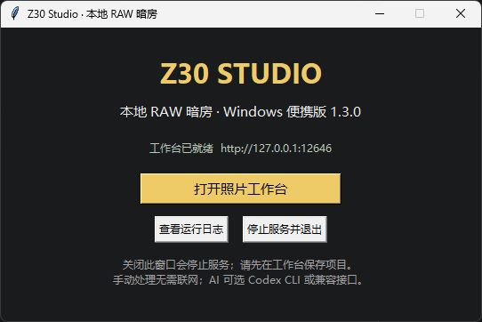
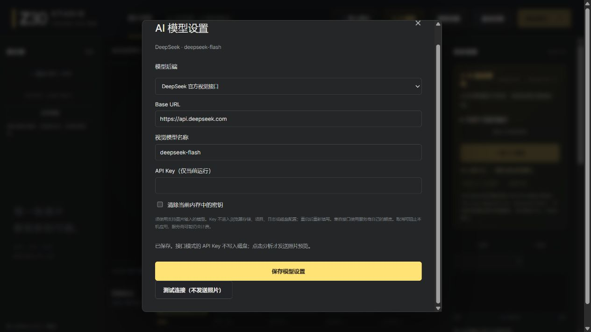

# Windows 便携版与多模型验收

版本 1.3.0，2026-10-24。打包为 Windows x64 文件夹式 EXE：内置 Python 3.14.6、rawpy 0.27.1 / LibRaw 0.22.1、NumPy、Pillow、tifffile 和 Tcl/Tk；用户完整解压后启动 `Z30-Studio.exe`，保留 `_internal`。打包器 PyInstaller 6.22.3，固定构建依赖并附带第三方许可。

## 修改与回归

| 提交 / 范围 | 主要文件 | 验证 |
| --- | --- | --- |
| `b68efad` Windows 程序 | `desktop.py`, `app_runtime.py`, `server.py`, `Z30-Studio.spec`, `tools/build_windows.py`, `tests/test_runtime.py` | 原生启动窗口、退出按钮；源码/冻结资源定位、用户数据分离、独占端口及实例锁；93 Python / 25 Node 通过 |
| `3dc1f6b` 多模型 | `api_backend.py`, `codex_assist.py`, `server.py`, `web/model-settings.js`, 页面与回归 | 默认 Codex 登录命令不变；DeepSeek 视觉预设、通用接口、仅内存密钥、取消、严格输出和画质回退；101 Python / 25 Node 通过 |
| 交付验收 | `tools/smoke_windows.py`、构建脚本、许可、报告与截图 | 从 ZIP 解压运行实际 EXE；包含本地模拟模型的完整 HTTP 路径，三轮完整启停均通过 |

原有 11 项 CLI 契约测试未修改。CI 没有外部 NEF 时跳过两个实 RAW 方法；Linux 另跳过 Windows 命名互斥锁方法。

## 实际 EXE 检查

测试从 ZIP 解压到包含中文与空格的临时路径，工作目录另设到其他位置；清除 PATH 中的 Python 目录及 PYTHONHOME/PYTHONPATH，再运行 EXE。验证全部网页资源、12/14 位 NEF 原尺寸、无损检视、JPEG/PNG/RGB16 TIFF、原片 SHA256 不变、便携项目字节校验及重开、后台导出重启恢复、实例锁和正常退出。此测试证明无需通过 PATH 找 Python；**没有在卸载 Python 的干净虚拟机中验证**。

原生启动窗口及退出按钮经过 Windows UI 验收；也在 EXE 提供的网页中打开、选择并保存 DeepSeek 预设。密钥栏保持空白，截图没有用户凭证。

兼容模型以本地模拟服务器响应，实际 EXE 发送两张 data URL 预览、接收 JSON 参数并运行原尺寸预览画质回退，推理请求恰好一次；配置文件不含模拟密钥，重启后 `has_key=false`。Codex 检测沿用本机登录，未新发起 Codex 模型调用。

另用故意无效的测试字符串访问 DeepSeek 官方 `GET /models`，实际 EXE 通过 HTTPS 收到预期 401；这验证 TLS/网络与错误处理，**不是有效认证或视觉推理验收**。没有真实 DeepSeek API Key，因此真实云端图像分析和调色质量尚未验证，也没有产生 DeepSeek 推理调用。

## 退出超时继续排查（2026-10-24 晚）

在上一版 1.3.0 交付构建（源码 `67015ba`，EXE SHA256 `f776108a…`）上追加验证；随后以源码 `1883518` 重新构建并替换当前交付 ZIP（EXE `0a1d7fc3…`，ZIP `0c87e657…`）。以下历史数据用于对照：

- 追加 8 轮完整 EXE 验收（12/14 位 RAW、TIFF16、项目重开、模拟模型、重启恢复），全部通过；连同原记录共 11 轮连续通过。带计时的 3 轮每轮总耗时 54.07–55.17 秒，两次优雅退出分别耗时 0.295–0.537 秒。
- 30 次空载启动/停止：0.426–0.534 秒。
- 5 次在全尺寸 14 位 RAW 同步 TIFF16 请求仍在执行时停止：0.574–0.593 秒。HTTP 请求线程是 daemon，不阻塞进程退出。
- 修复前后台全尺寸 RAW TIFF16 编码中停止（源码启动器）曾等待 18.14、19.32、19.92 秒。`ExportQueue` 已改为单一 daemon worker + 有界 `shutdown`（默认 5 秒）：超时后不再等待当前单张编码，任务标记 `interrupted`，迟到结果不会发布；重启清理 `.part` 和 `manifest.json.tmp`。源码实测退出 **5.576 秒**，重启后任务为 `interrupted`、无残留 `.part`。新增 2 项导出回归覆盖有界退出/排队任务/迟到结果和重启清理。
- 用户补充说明：两次历史 30 秒等待发生在使用 Codex 调试该软件期间，属于调试环境/工具链因素；普通路径未复现，因此不再作为产品运行时缺陷追根因。这次修复的是另一个具体长等待路径。
- 新增诊断：关停阶段耗时、停止后每 10 秒重复线程转储（`logs/shutdown-stacks.log`）、smoke 每轮 `shutdowns` 秒数，以及 `tests/test_shutdown.py` 无头启动器退出回归。诊断与有界关停代码已打入当前 `1883518` 交付 EXE；上一版 `67015ba` 没有。
- 当前 `1883518` 交付构建最终完整 smoke 通过，两次退出 **0.388 / 0.534 秒**；有界后台导出关停在同构建 EXE 实测 **5.583 秒**。该构建首轮自动 smoke 在 20:15 曾出现一次 30 秒停止等待且无 shutdown 日志，立即重跑通过；未定位，保留观察，不能归因于有界关停修复。
- 结论：后台导出的无界等待已修复并进入当前交付 EXE；早期 30 秒等待主要按用户说明归因于 Codex 调试环境，但新构建首轮 smoke 又偶发一次、重跑通过，因此仍保留观察，不能宣称该现象已彻底消失。

## 剩余风险

- 早期全 RAW 验收两次退出等待超过 30 秒；用户补充说明主要发生在使用 Codex 调试软件期间。普通构建的 11 轮完整验收、30 次空载启停和原生按钮退出均通过；但新构建首轮 smoke 在 2026-10-24 20:15 又偶发一次，重跑通过，仍未定位，保留观察。日志位于用户数据目录 `logs/`；诊断模式超时会留下 `shutdown-stacks.log`。
- 只在当前 Windows x64 主机实测；其他系统版本、ARM64、干净虚拟机、实拍人像及实镜网格未验证。程序未代码签名。
- DeepSeek / 兼容服务使用自己的账户额度。程序不自动重试；取消可阻止本机应用，无法承诺服务商停止计费。密钥仅当前运行有效。
- 已有手动镜头、传统降噪、蒙版构图位置和全尺寸处理成本仍适用之前的工作台限制。

机器可读记录：[Windows 验收 JSON](windows-portable-validation.json)。构建与使用：[便携版说明](../windows-portable.md)；模型协议：[多模型说明](../model-backends.md)。

