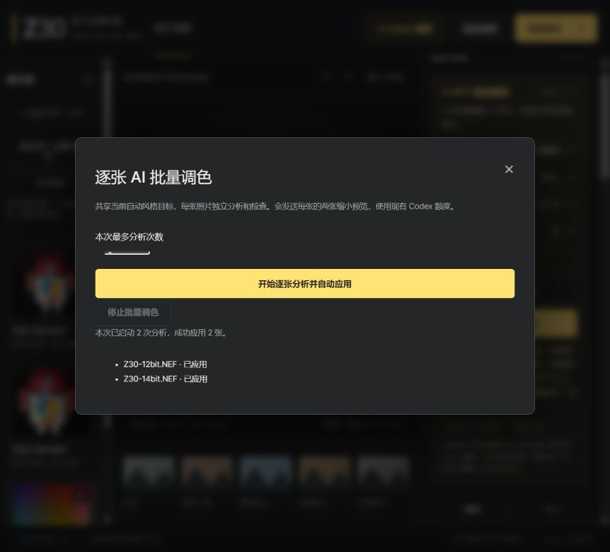
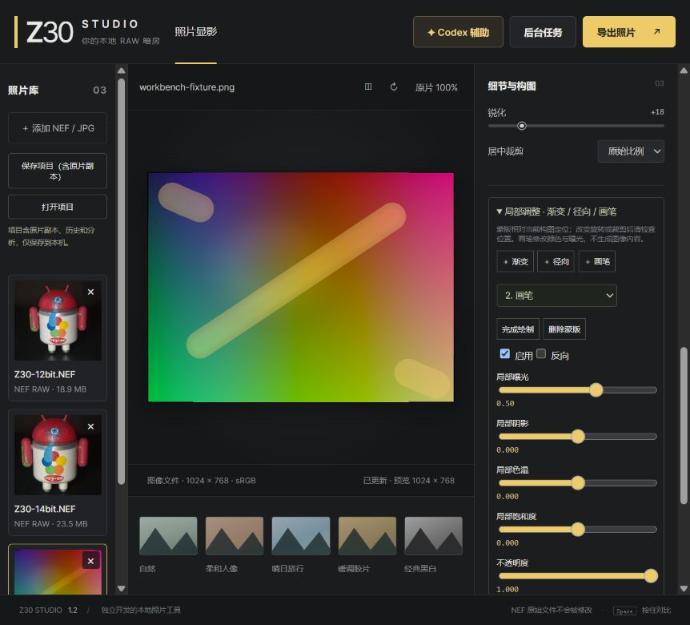
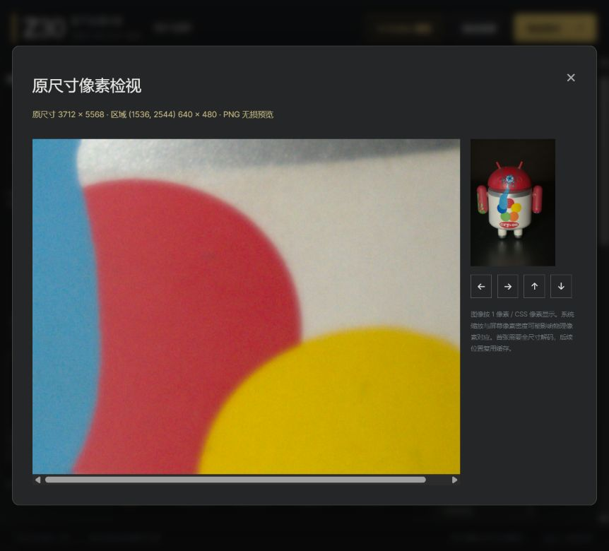

# Photo workbench expansion

## Editing history and portable projects

`web/history.js` stores up to 50 immutable states per photo, including preset and nested settings. Consecutive slider updates coalesce; undo followed by another edit discards that redo branch. Undo/redo buttons, history selection and Ctrl+Z/Ctrl+Shift+Z/Ctrl+Y share the same history. History also covers manual recipes and AI changes. Browser session restoration preserves the cursor.

Save Project downloads a `.z30proj` ZIP containing **original photo copies**, JSON settings, history and analysis. No original is overwritten. Files stay on this computer; the archive itself is sensitive to the extent its photos are sensitive. It can reopen after the server restarts without locating the originals again. Maximum 8 photos, 512 MiB total, 150 MiB per photo and 50 history states per photo.

Projects stream to the browser without a duplicate archive on disk. A short-lived download ticket pins only its input photos; expired unused tickets release those pins. Imports validate version, canonical archive names, counts, sizes, SHA256 and history cursor/settings, then decode; any import error rolls back the newly created photo sessions. Encrypted, linked, undeclared and path-traversal archive entries are rejected. Existing open photos remain unchanged.

Tests: portable original/history roundtrip, corrupt hashes, undeclared paths, future versions, inconsistent history, HTTP save/reopen and source pins; Node tests cover coalescing, baseline preservation, redo branches, bounded size and deep snapshots.

## Native-resolution inspection

The original 100% preview toggle is replaced by a full-resolution inspector. The backend decodes and renders the full image with the same geometry/processing as export, caches its read-only RGB8 output under the existing byte budget, and returns a bounded lossless PNG crop. No resize is used for that crop. A minimap and navigation choose another area. Pixel mapping is 1 image pixel per CSS pixel, subject to OS/device scaling. The first view may take several seconds; new settings invalidate the cache. This verifies focus/noise/sharpening on the actual full render rather than the reduced RAW preview. The HTTP regression compares the returned pixels exactly with the native renderer and tests cache reuse.

## Per-photo AI batch and preferences

Automatic styles include natural, portrait, warm film, product and night. Maximum interpolation strength, exposure delta and colour delta are enforced locally before quality fallback. The personal style text and choices persist in browser localStorage; no API credential is stored. The CLI command/login and JSON schema remain unchanged.

The batch dialog explicitly chooses a maximum number of photo analyses (1–8). Photos are analyzed sequentially, with a common style and the first successful summary as a semantic reference. Every photo receives independent settings and quality fallback, rather than copying one photo's sliders to all others. Editing a queued photo skips it; edits to another photo do not invalidate the batch item. Each completed item gets its own history and AI undo point. Stop cancels the active job and leaves later items unstarted. An uncertain remote cancellation stops the queue, preserving reconnect IDs. This uses existing Codex quota once per started photo; ordinary tests use mocks and do not spend quota. Shared semantic style is not a promise of calibrated colour matching across scenes.

Tests cover local strength/delta bounds, categorical geometry preservation, invalid preferences, sequential execution, request budgets, queued edits and stopping after uncertain network errors.

## Local masks, denoise and manual optics

Linear gradients, feathered radial masks and painted strokes apply local exposure, shadow, temperature and saturation changes in float32, before global tone/gamut mapping. Up to 8 masks and 512 brush points are accepted; enabled/invert/opacity/feather and per-mask controls are editable. Stroke segments use analytic distance with bounded bounding boxes. Mask coordinates are relative to the final composition: review their positions after changing rotation/crop. Every mask edit participates in history, recipe/project saving, preview, native inspector and TIFF16 export.

Separate luminance/chroma noise controls use a small edge-aware weighted neighbourhood in linear RGB after decode. This is conventional denoising, not an AI restoration model. Spatial weights and luminance differences reduce averaging across strong edges; results can still soften texture and cannot restore lost details. Processing uses strips with two-row halos. When optical correction already owns a temporary array, denoise reuses it with preserved original halo rows instead of allocating another full-frame float buffer.

Manual radial correction maps output coordinates back to the source using `1+k1*r²+k2*r⁴`, with radius normalized by the larger half-dimension. Red/blue chromatic-aberration controls add per-channel radial scale in per-mille; vignette compensation is an exposure gain proportional to radius squared. Bilinear sampling stays float32. Out-of-frame regions are black and can be cropped. User profiles save/load this explicit `centered-radial-v1` convention, not Lensfun XML. No lens profile coefficients are fabricated or automatically matched to EXIF. These controls have synthetic geometric tests but **no real lens/grid calibration** supplied.

References for the algorithm families: [Lensfun distortion/TCA descriptions](https://lensfun.github.io/manual/latest/group__Lens.html) and [MIT bilateral-filter references](https://people.csail.mit.edu/sparis/bf/). The implementation is independent NumPy code, with no imported Lensfun database or third-party filter source and no new paid API/model dependencies.

Synthetic tests cover disabled identity, mask support/inversion, exact chunk-boundary agreement, reduced flat-field noise with edge preservation, chroma-only luminance preservation, in-place halo equality, channel-specific optics and genuine >256-level uint16 output. Preview and full-size denoise work at different sampling resolutions; evaluate final texture in the native inspector. Quality fallback changes only the nine GPT-editable global controls and preserves manually configured masks/optics/denoise.

## 分阶段修改、测试和剩余限制（2026-10-24）

以下表格对应独立 Git commit，测试列列出当前完整套件中的覆盖，均已通过；阶段后的组合操作验收另行提交修复。

| 提交 / 阶段 | 主要修改文件 | 回归与验收结果 | 剩余限制 |
| --- | --- | --- | --- |
| `85c7387` 历史与项目 | `projects.py`, `server.py`, `web/history.js`, `web/app.js` | 3 个项目测试、HTTP 字节一致往返、原片下载锁、历史快照 / 分支 / 限额通过 | 原片副本需要保管；8 张 / 512 MiB；浏览器自动保存可能缩减历史 |
| `23c699e` 原尺寸检视 | `server.py`, `web/app.js`, `web/index.html`, `web/style.css` | 非零区域裁剪、边界钳制、旋转裁剪及缓存精确逐像素比较通过；实际 NEF 区域 640×480，CSS 显示亦为 640×480 | 首次需全片显影；显示仍受系统缩放影响 |
| `048e1c5` 独立 AI 批量与偏好 | `automation.py`, `codex_assist.py`, `server.py`, `web/batch-grade.js`, `web/app.js` | 本地约束 2 个测试、顺序 / 次数预算 / 编辑跳过 / 取消 3 个 Node 流程测试通过；真实 CLI 分别应用两张 RAW | 每张使用一次现有 Codex 额度；语义共用风格不等于色卡匹配 |
| `bff38ac` 局部、降噪与手动镜头 | `spatial.py`, `processing.py`, `server.py`, `web/app.js` 及界面 | 7 个空间处理测试、原位 halo 一致性、原片不变、受保护导出保留手工参数、实际 14 位 RAW TIFF16 读回通过 | 传统降噪会柔化纹理；无实镜标定、无实拍人像 / 色卡验证 |
| `cb726fb`, `5ec2bed` 组合操作修复 | 上述前后端、项目和回归测试 | 恢复后蒙版可选；独立笔划无连接；预设保留手工修正；AI 基线和撤销深拷贝；项目携带 AI 撤销点；异步参数载入拒绝过期状态 | 历史最多 50 步；蒙版相对最终构图，旋转 / 裁剪后需检查位置 |

完整本地运行：**89 项 Python、25 项 Node 全部通过**，包括原有未修改的 11 项 CLI 契约测试和两项真实 Z30 RAW 集成检查。CI 使用生成夹具，在没有外部 NEF 时明确跳过那两项。正常回归测试使用模拟 CLI，不消耗模型额度。

真实浏览器验收使用公开 CC0 的 12/14 位 NEF 和自制 1024×768 渐变夹具：

- 明确上限 2 次，实际调用 2 次，逐张分析并应用。产品风格、50% 强度、曝光变化上限 0.5 EV、色彩变化上限 10；结果曝光为 +0.175 / +0.225 EV，均满足本地插值后的 ±0.25 EV 上限，色彩变化亦在 ±5 内。两张分别通过原尺寸预览检查。
- 保存 44,446,872 字节项目，验证三份源文件 SHA256、当前历史节点与参数一致；停止服务、重启后重新打开，三张原片及分析、历史、两个蒙版、色彩降噪 100 和 k1=0.005 均恢复。撤销 / 重做及镜头 JSON 保存 / 载入通过。
- 恢复后又画了两条独立笔划，参数包含 19 点及分段 `[9, 14]`；笔划间没有连接。切换人像预设后，蒙版、降噪、镜头、方向、裁剪和白平衡保持一致。
- 实际 14 位 RAW 在局部 + 降噪 + 镜头流程导出为 3712×5568 RGB uint16 TIFF，ICC 正确，红通道有 65,536 个不同数值，非 8 位扩展；NEF SHA256 不变。

原始记录：[真实流程](reports/workbench-live.json)、[TIFF16 读回](reports/workbench-tiff16.json)。公开静物样片及合成梯度不能证明人像肤色质量、实镜校正准确性或更多 RAW 方向；这几项仍未实机验证。







## 耗时、内存与颜色对比

同一公开 14 位 NEF、同一组全局调色参数，每个阶段用独立进程执行两次；耗时取中位数，RSS 取两次峰值且包含前置解码。RSS 是整个进程的高水位，不是该操作单独分配量；耗时受本机负载影响。旧版为 `f33a33a` 对应记录。新增选项全部关闭时，RGB 通道均值、剪切比例和 JPEG 字节数与旧版**完全一致**。

| 操作 | 旧版 秒 / MiB | 当前默认 秒 / MiB | 开启空间处理 秒 / MiB |
| --- | ---: | ---: | ---: |
| 全尺寸解码 | 1.036097 / 401.3 | 1.139977 / 401.5 | 1.113196 / 401.5 |
| 缩小解码 | 0.456435 / 155.4 | 0.503577 / 155.6 | 0.504012 / 155.6 |
| 全尺寸显影 | 4.388985 / 431.3 | 4.952832 / 431.4 | 15.870722 / 635.7 |
| 已有解码的首次预览 | 0.636943 / 155.6 | 0.711490 / 155.8 | 1.401521 / 155.6 |
| 同参数重复预览 | 0.000029 / 155.5 | 0.000069 / 155.4 | 0.000099 / 155.4 |
| 16 位 TIFF 导出 | 8.286925 / 632.6 | 9.236541 / 632.7 | 20.233050 / 694.9 |

空间处理示例额外使用：亮度降噪 35、色彩降噪 40、k1=0.015、红 / 蓝径向色差 +1 / -1‰、暗角 20，以及径向局部曝光 +0.3 EV。这是性能负载示例，参数未经镜头标定，并非推荐配方。其红通道剪切比例由 0.36% 增至 1.43%；手工提亮仍需检查直方图。自动保护保留手工空间设置，只回退 GPT 的全局建议。

默认路径本次全尺寸显影比旧版采样增加约 0.56 秒，峰值 RSS 近似不变；启用全部示例处理增加了显影时间和约 204 MiB 峰值 RSS。实现通过复用镜头修正产生的浮点数组做降噪，省去另一个约 236.5 MiB 的 20MP RGB float32 副本；独立测试验证了复用及条带边界的一致性。原尺寸检视的首次全片处理同样有成本，后续区域导航复用受 128 MiB 容量约束的 RGB8 缓存。

数据：[旧版](reports/reliability-isolated.json)、[当前默认](reports/workbench-default-isolated.json)、[开启空间处理](reports/workbench-spatial-isolated.json)。可复现命令：

```powershell
python tools/benchmark_pipeline.py --samples D:/samples/Z30-14bit.NEF --isolated --repeat 2 --out baseline.json
python tools/benchmark_pipeline.py --samples D:/samples/Z30-14bit.NEF --isolated --workbench --repeat 2 --out spatial.json
```
